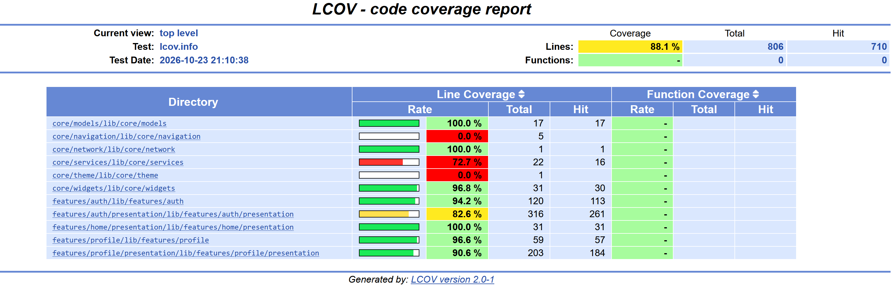
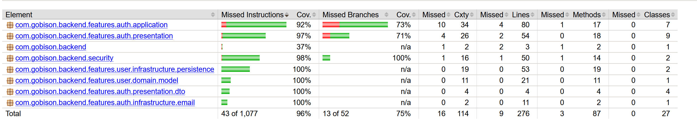
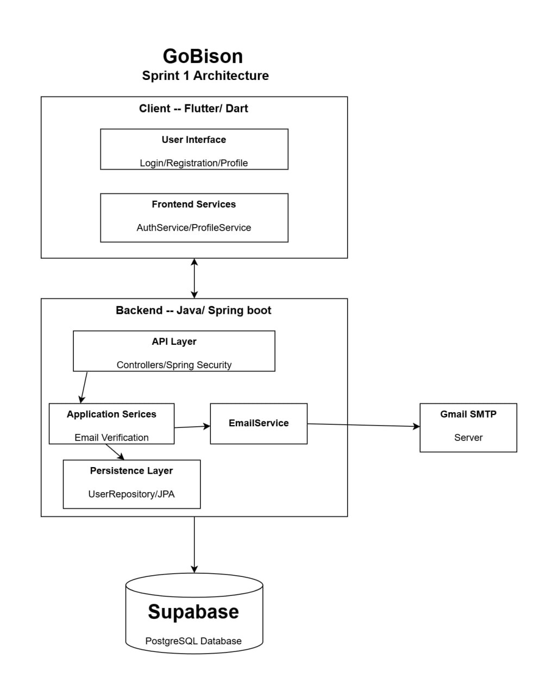

# Sprint 1

## Sprint Summary
For this sprint, our team focused on implementing the core account management features. Account creation, and user verification features have been implemented end to end and backend infrastructure to support the application has been established.

We have also deployed our application [here](https://gobison.popicraft.net/)

## Completed Work
- Account creation
- Account verification
- Login
- Database integration
- Basic CI/CD pipeline
- Live deployment

## Testing Status

The team currently uses a combination of unit, integration, and frontend widget tests to verify the functionality of our application.

**Frontend Testing:** Flutter widget tests verify registration form validation, including required fields, UMNetID formatting, password length, and acceptance of valid input.

**Unit Testing:** We use JUnit 5 to test the User domain model and EmailService. These tests cover object initialization, getters and setters, email message contents, and SMTP failure handling. We also test UserRepositoryImpl to verify repository behaviour and mapping between domain objects and persistence entities.

**Integration Testing:** EmailVerificationServiceIntegrationTest tests interactions between the verification service, repository, and PostgreSQL database.

**API and Security Testing:** Using Spring Boot's @WebMvcTest and MockMvc, we test the email-verification REST endpoint, including successful responses, authentication requirements, malformed requests, expected error responses, and handling of persistence failures without exposing internal details.

**Mocking/Test Utilities:** We use Mockito to mock the email service and verify interactions without sending real emails.

**Coverage and Evidence:** Our CI pipeline generates coverage reports, allowing us to identify under-tested areas.

## CI Status
For this sprint, we have implemented basic CI pipelines for the frontend and backend applications. These will run upon pushes, creation/reopening of pull requests, and updates to pull requests. 

The pipelines will do the following:
- install dependencies
- analyze code
- run tests and collect coverage
- generate coverage report

[CI documentation](../../Ci.md)

## API Documentation
[Postman API documentation](https://www.postman.com/moreaboutrebekah-4859954/gobison/http-request/mmrfr8n/register-account?sideView=agentMode)

## Architecture

## Deployment and Local Setup
[Deployment URL](https://gobison.popicraft.net)

[Backend setup](../../Backend.md)
[Frontend setup](../../Frontend.md)

## Reflection

Our team is particularly proud of the frontend design of our application. We feel that we have created an interface that looks and feels like a real application that students could use in their day-to-day lives. Throughout the design process, our frontend team focused on making the application visually appealing, intuitive, and easy to navigate. Additionally, by choosing to use Flutter it allowed us to develop an application that can run on both mobile devices and web browsers. This flexibility is especially valuable because students may access the application in different situations, whether they are using their phones while walking around campus or accessing it through a web browser on their laptops. We are proud of the effort our team has put into creating an interface that resembles a real-world application rather than a basic academic assignment

One area which our team feels could have been improved was initial database setup. Schema changes had to be made during the sprint, and it would have been much easier if we had better established everything needed from our database tables at the beginning of the iteration. These changes then required team members to change multiple classes and tests, which slowed our progress throughout this sprint. We also believe that we could improve our communication and time management skills in the next sprint, as this held us back in the days leading up to the deadline.

Our team focused on testing during and after implementation. Unit tests were created when classes for a particular feature were completed, and integration tests were created after all layers of a feature were complete. Our team doesn’t think a more test-driven approach would have made the sprint easier or harder, as our current testing approach worked well this iteration.

## Known Issues
One issue that the team knows of is that users are not able to log out once they've logged in. So after account registration, if you want to test logging in, you need to restart this app. This will be fixed in sprint 2. 

