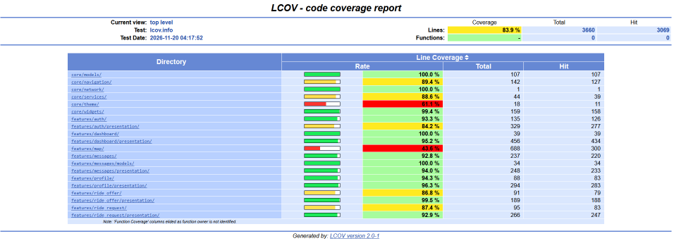
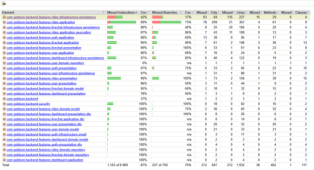

# Sprint 2

## Sprint Summary

This sprint, our team focused on building out our core features and implementing the majority of our project's functionality. We introduced the ability for users to edit their profiles, post ride requests and offers, chat in real-time with other users, view their dashboard summarizing all of their agreements, and browse nearby postings on a map. We also made sure to smooth out any outstanding issues from sprint 1, like minor issues with cookies and deployment.

## Completed Work

- Allow users to edit their profiles
- Dashboard showing users all of their current agreements and postings
- Users can now create ride requests and offers
- Implemented a map that displays all open ride offers and requests nearby
- Allow users to edit and delete their ride agreements
- Allow users to delete their account
- Implemented live chat functionality for users to talk to eachother
- Added regression tests to our automated test suite
- Added linting to our CI pipeline
- Improved CD to only run after the CI pipeline finishes.
- Deployment runs in its own contained database running via Docker

## Regression Testing

We run the full regression suite on every push and pull request. Changes to
shared features such as login can affect several workflows, and the full
suite is practical to run. On commit `39791f2`, the longest workflow took
three minutes.

- Backend CI runs Maven tests for the API, services, and database layer.
  For example, the logout test checks that the old session receives HTTP 401
  when it tries to access the account again.
- Flutter CI runs static analysis, unit tests, and widget tests, including
  tests for the dashboard, ride requests, and ride offers.
- Flutter Integration Tests checks registration and email verification in
  Chrome using a mock backend.

If a test fails, the developer can find the failed assertion in the GitHub
Actions log and reproduce it locally. Pushing a fix runs the suite again.

All three workflows passed on `dev` commit `39791f2`.

| Workflow | Total duration | Line coverage |
| --- | --- | --- |
| [Backend CI #397](https://github.com/popcorn9499/future-problems/actions/runs/44673216329) | 1 min 21 sec | 89.0% (1,720 of 1,932 lines) |
| [Flutter CI #402](https://github.com/popcorn9499/future-problems/actions/runs/44673216079) | 2 min 16 sec | 83.9% (3,069 of 3,660 lines) |
| [Flutter Integration Tests #326](https://github.com/popcorn9499/future-problems/actions/runs/44673216106) | 3 min | Not collected |

The map page had 43.6% line coverage. The Flutter suite did not exercise
opening ride details from the map. A useful next test would select a ride
and check that its details appear.

## Testing Status & Gaps

The team currently uses a combination of unit, integration, and frontend widget tests to verify the functionality of our application, and all tests are run upon pushes and pull requests through our CI pipeline.

See our [testing documentation](../../Testing.md) for more details about our testing approach for GoBison.

There are some testing gaps we are aware of, and would like to address in the next sprint.
One gap in our frontend testing is the fact that the layouts are all tested at the same size, meaning we could miss overflow issues on smaller screen sizes. This gap exists mostly due to lack of awareness and then lack of time, as the team did not think or know about this until late into the sprint. To fix this, we should add widget tests that run on smaller screen sizes next sprint.

Another gap exists, where a couple of features are missing integration tests that test different layers together. For example, the dashboard and creation of ride requests/offers do not have integration tests that use both the frontend and backend together. Again, this was due to lack of time this sprint and we will be sure to remedy this in sprint 3 by ensuring all features have integration tests.

A specific area that is weakly tested is our ride logic (creation of ride offers and requests). The persistence files for this feature have a low coverage percentage meaning we know some areas have not been tested. This gap exists again due to time constraints, but we will make sure to prioritize fixing this in the coming weeks.

We also currently have no tests that measure performance, so we do not yet know how the app and database will respond to higher amounts of traffic and queries. Our dashboard logic makes a lot of queries to the database, and could possibly return a very large amount of data to the frontend, so this could be a high-risk area that's untested. This gap exists as we considered other types of tests to be the priority this iteration. Next sprint, we will make sure to add tests to measure our app's performance.

Another area which might be considered a testing gap is accessbility. Flutter has built in tools for testing accessibility, which can measure how well the app is meeting accessbility guidelines for contrast, sizes, and labels that we did not get to utilize this sprint. The reason that this gap exists is that we hadn't even considered that this was a possible test type until the end of the sprint, and we were not aware flutter had tools for this. We would like to implement some tests using them during the next iteration.

In terms of coverage, our tests are covering an acceptable percentage of code but we acknowledge that this only means the lines/branches ran, and not that all inputs and behaviour are being thoroughly tested. We also acknowledge that certain areas have coverage percentages that should be improved. We will aim to include a wider variety of test types and test more possible behaviours next sprint.

## CI/CD Status

[CI Documentation](../../Ci.md)

[Deployment documentation](../../Deployment.md)

## Live Deployment

[Deployment link](https://gobison.popicraft.net/)

## Cross-Team Testing

### Our Review

[Review completed for group 3](https://github.com/laradeleon/the-story-machine/issues/95)

### Our Feedback

One piece of feedback we received in this [Git issue](https://github.com/popcorn9499/future-problems/issues/230) from our reviewers that we are classifying as accepted, is that we should make improvements to our profile editing. They pointed out an issue where changes made to the user's profile details are not reflected in the frontend. So a user would edit their profile, and upon saving, it would appear that the changes were not saved. We have already fixed this issue and now the user's changes will appear in the frontend immediately.

In a another [Git issue](https://github.com/popcorn9499/future-problems/issues/232), the team reviewing us suggested we indicate which requests belong to the user and grey out the message button for those requests. However we have built our map so users will never see their own requests or offers and can instead view them in the dashboard. As such, we are rejecting that feedback and instead will find a way to make it clear in the frontend that your personal requests/offers won’t be shown in the map.

## API Documentation

[Postman API documentation](https://www.postman.com/moreaboutrebekah-4859954/gobison/http-request/mmrfr8n/register-account?sideView=agentMode)

## Architecture

## Reflection & Risk

### What technical decision or implementation improved most since Sprint 1, and why?

**Leon**: The implementation that we would say has improved the most since Sprint 1 would have to be specifically, Users. In the conclusion of Sprint 1, people were able to sign up, log in, and authenticate their accounts, storing that authentication for a User. With Sprint 2 coming to a close, we've made significant progress on User related features. Users now have a profile with associated details stored, from an "About me" section to even a colour for their profile icon. Users can now logout of their account at will, and delete their account from our service. A user of our application can now do the expected actions assumed for User functionality, whereas Sprint 1 was minimal in that regard.

**Rebekah**: One of the implementations that improved the most since Sprint 1 was our session management. We revisited how login sessions were handled and made improvements to ensure that users remain authenticated as they navigate the application and open it across multiple tabs. This made the login experience more consistent and reliable, while ensuring that users don't have to repeatedly log in when accessing the application.

### What feedback from Sprint 1 did the team act on, and what changed as a result?

**Kamryn**: We received feedback from Lauren during our demo that some details of our profile page could be improved. This included our use of a dropdown gender field. After a group discussion we decided to change it to a pronouns textfield. This way users had full control over how they wanted to be addressed by other users.  In the same meeting Lauren suggested that users should have some control over how their user avatar looks and because of this we decided to implement an avatar colour selector in the edit profile page.

### What part of the current testing, CI, or CD process creates the most friction, and what might improve it?

**Ruitian**: Up until recently we didn’t realize you can chain action files against each other. This meant that if ci failed if we didn’t have those checks in the deploy file things might deploy that are broken. We solved this later by ensuring deploy only runs when the actions prior that are used to test everything pass. This created a lot of potential for friction however was resolved relatively easily by reading the documentation for github actions. I checked three GitHub Actions runs to make sure the backend, frontend, and browser tests all passed on the same commit. An automatic summary of those results would save time when we prepare the next sprint report.

### What is the most important technical risk or uncertainty going into the final iteration?

**Sasha**: There are some areas of uncertainty and technical risk in our project going into the final sprint. The ability to actually join other people’s postings is not implemented yet, nor is the ability for the creator of a posting to approve people joining. This is a possible risk going forward, as this implementation could affect surrounding features in ways we have not thought of yet and it’s arguably one of the most important workflows of our application. There is also some uncertainty surrounding how this might be implemented since there were some previously unconsidered rules and semantics surrounding this feature that came up this sprint, and it is also not fully decided how exactly we want to handle this functionality (e.g. should we have a notifications page, or should requests to join appear in the user's dashboard).

**Logan**: Our application backend currently validates that the schema is correct but has no way to update unless a user intervenes. This poses a huge risk of deploying something that then breaks the backend server from running until a human intervenes. This can create a lot of headaches and should be resolved as soon as possible.

**Carina**: One technical uncertainty going into the final iteration is how users can post a ride when our address lookup can’t find their pickup location. We’ve tested a range of address types, and the app already distinguishes an invalid address from a temporary lookup failure, but in the event a user is unable to enter their address, we don’t have an alternative way for them to do so. We could consider a fallback such as letting users select a pickup point on a map so they can still post a ride request even if the pickup fails.

#### Work the team is proud of

Our team believes the frontend as a whole reflects the quality of this sprint well, as we feel that our user interface is intuitive, organized, and looks good visually. In particular, our map frontend, [found here](../../../frontend/lib/features/map/map_page.dart), is a good display of this sprint's quality as we feel it was a big undertaking to make this feature look clean while also being user-friendly and functional.

We also feel that our CI pipeline is a good reflection of the sprint's quality, as we believe it is well done and covers a variety of important tasks. This was selected partially due to how helpful it has been to all team members during development, and also due to how well it was set up.
