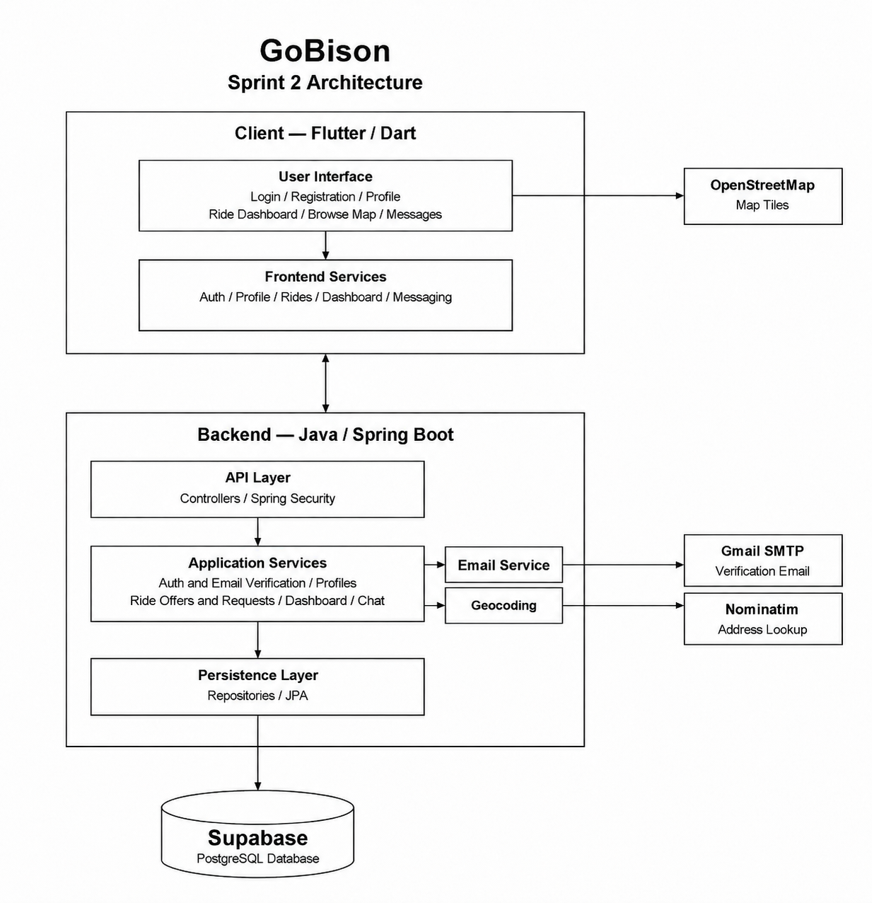

# Sprint 1

## Sprint Summary

This sprint, our team focused on building out our core features and implementing the majority of our project's functionality. We introduced the ability for users to edit their profiles, post ride requests and offers, chat in real-time with other users, view their dashboard summarizing all of their agreements, and browse nearby postings on a map. We also made sure to smooth out any outstanding issues from sprint 1, like minor issues with cookies and deployment.

## Completed Work

- Allow users to edit their profiles
- Dashboard showing users all of their current agreements and postings
- Users can now create ride requests and offers
- Implemented a map that displays all open ride offers and requests nearby
- Allow users to edit and delete their ride agreements
- Allow users to delete their account
- Implemented live chat functionality for users to talk to eachother (they can initiate a conversation from a posting they're interesting in joining)
- Added regression tests to our automated test suite
- Added linting to our CI pipeline

## Regression Testing

## Testing Status & Gaps

The team currently uses a combination of unit, integration, and frontend widget tests to verify the functionality of our application, and all tests are run upon pushes and pull requests through our CI pipeline.

See our [testing documentation](../../Testing.md) for more details about our testing approach for GoBison.

There are some testing gaps we are aware of, and would like to address in the next sprint.
One gap in our frontend testing is the fact that the layouts are all tested at the same size, meaning we could miss overflow issues on smaller screen sizes. This gap exists mostly due to lack of awareness and then lack of time, as the team did not think or know about this until late into the sprint. To fix this, we should add widget tests that run on smaller screen sizes next sprint.

Another gap exists, where a couple of features are missing integration tests that test different layers together. For example, the dashboard and creation of ride requests/offers do not have integration tests that use both the frontend and backend together. Again, this was due to lack of time this sprint and we will be sure to remedy this in sprint 3 by ensuring all features have integration tests.

We also currently have no tests that measure performance, so we do not yet know how the app and database will respond to higher amounts of traffic and queries. Our dashboard logic makes a lot of queries to the database, and could possibly return a very large amount of data to the frontend, so this could be a high-risk area that's untested. This gap exists as we considered other types of tests to be the priority this iteration. Next sprint, we will make sure to add tests to measure our app's performance.

Another area which might be considered a testing gap is accessbility. Flutter has built in tools for testing accessibility, which can measure how well the app is meeting accessbility guidelines for contrast, sizes, and labels that we did not get to utilize this sprint. The reason that this gap exists is that we hadn't even considered that this was a possible test type until the end of the sprint, and we were not aware flutter had tools for this. We would like to implement some tests using them during the next iteration.

In terms of coverage, our tests are covering a good percentage of code but we acknowledge that this only means the lines ran, and not that all inputs and behaviour are being thoroughly tested. We will aim to include a wider variety of test types and test more possible behaviours next sprint.

// TODO: ADD COVERAGE REPORTS

## CI/CD Status

## Live Deployment

## Cross-Team Testing

### Our Review:

[Review completed for group 3](https://github.com/laradeleon/the-story-machine/issues/95)

### Our Feedback:

[Review received from group 1](https://github.com/popcorn9499/future-problems/issues/216)

Unfortunately, our deployment was down when the reviewing group tried to test our application and therefore they could only give very minimal feedback.

They were only able to leave us two pieces of feedback, both of which we classify as 'accepted' and believe should result in project work.

Firstly, they suggested improvements to the error message shown when deployment is failing in any way. The only message they were shown was 'unable to load your account' with a try again button, which provides little information. Going ahead, we need to account for any server or deployment issues, and display more meaningful error messages for users. It was suggested that in this case, we could have a message that instead states "The service is temporarily unavailable. Please try again later." which we think is a great idea.

The second reccomendation that we consider accepted is to document known issues. It has come to our attention that there could be small windows of time where the host will reboot, meaning users cannot access GoBison through our deployment. This should absolutely be noted in our deployment documentation and in our README, so future reviewers and graders can be informed.

## API Documentation

[Postman API documentation](https://www.postman.com/moreaboutrebekah-4859954/gobison/http-request/mmrfr8n/register-account?sideView=agentMode)

## Architecture

## Reflection & Risk

### What technical decision or implementation improved most since Sprint 1, and why?

**Leon**: The implementation that we would say has improved the most since Sprint 1 would have to be specifically, Users. In the conclusion of Sprint 1, people were able to sign up, log in, and authenticate their accounts, storing that authentication for a User. With Sprint 2 coming to a close, we've made significant progress on User related features. Users now have a profile with associated details stored, from an "About me" section to even a colour for their profile icon. Users can now logout of their account at will, and delete their account from our service. A user of our application can now do the expected actions assumed for User functionality, whereas Sprint 1 was minimal in that regard.

### What feedback from Sprint 1 did the team act on, and what changed as a result?

**Kamryn**: We received feedback from Lauren during our demo that some details of our profile page could be improved. This included our use of a dropdown gender field. After a group discussion we decided to change it to a pronouns textfield. This way users had full control over how they wanted to be addressed by other users.  In the same meeting Lauren suggested that users should have some control over how their user avatar looks and because of this we decided to implement an avatar colour selector in the edit profile page.

### What part of the current testing, CI, or CD process creates the most friction, and what might improve it?

### What is the most important technical risk or uncertainty going into the final iteration?

**Sasha**: There are some areas of uncertainty and technical risk in our project going into the final sprint. The ability to actually join other people’s postings is not implemented yet, nor is the ability for the creator of a posting to approve people joining. This is a possible risk going forward, as this implementation could affect surrounding features in ways we have not thought of yet and it’s arguably one of the most important workflows of our application. There is also some uncertainty surrounding how this might be implemented since there were some previously unconsidered rules and semantics surrounding this feature that came up this sprint, and it is also not fully decided how exactly we want to handle this functionality (e.g. should we have a notifications page, or should requests to join appear in the user's dashboard).

#### Work the team is proud of

Our team believes the frontend as a whole reflects the quality of this sprint well, as we feel that our user interface is intuitive, organized, and looks good visually. In particular, our map frontend, [found here](../../../frontend/lib/features/map/map_page.dart), is a good display of this sprint's quality as we feel it was a big undertaking to make this feature look clean while also being user-friendly and functional.

We also feel that our CI pipeline is a good reflection of the sprint's quality, as we believe it is well done and covers a variety of important tasks. This was selected partially due to how helpful it has been to all team members during development, and also due to how well it was set up.
